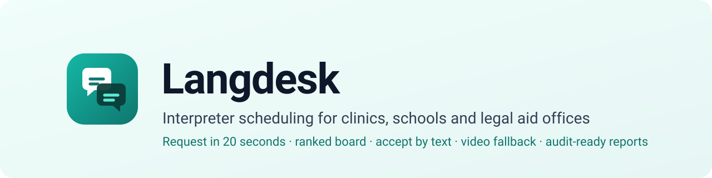
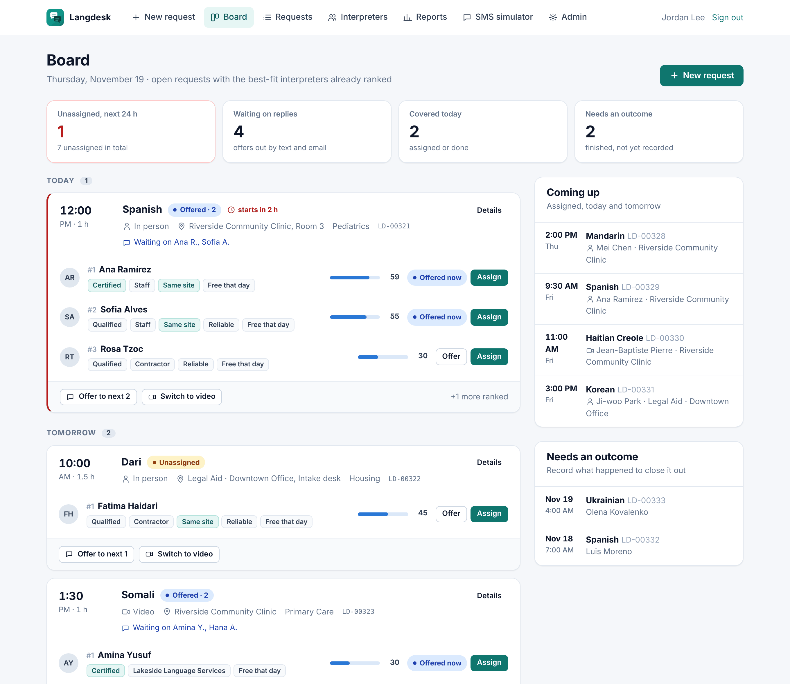
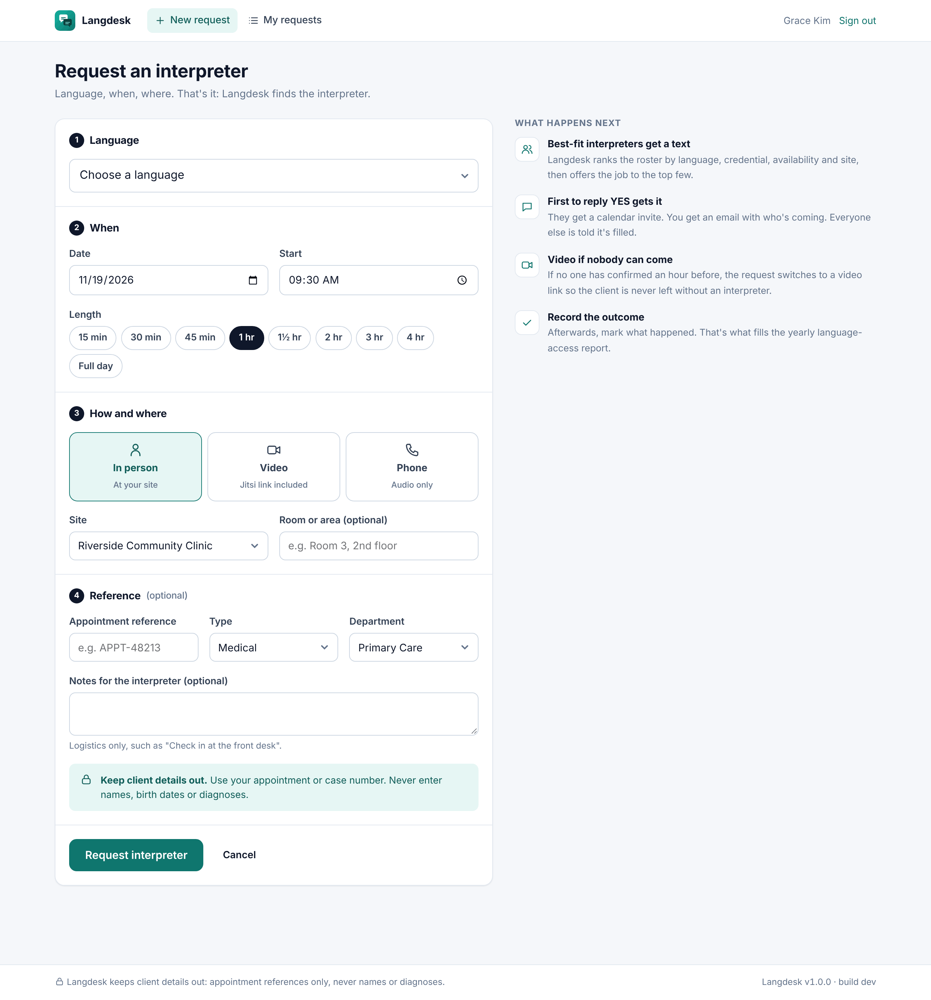
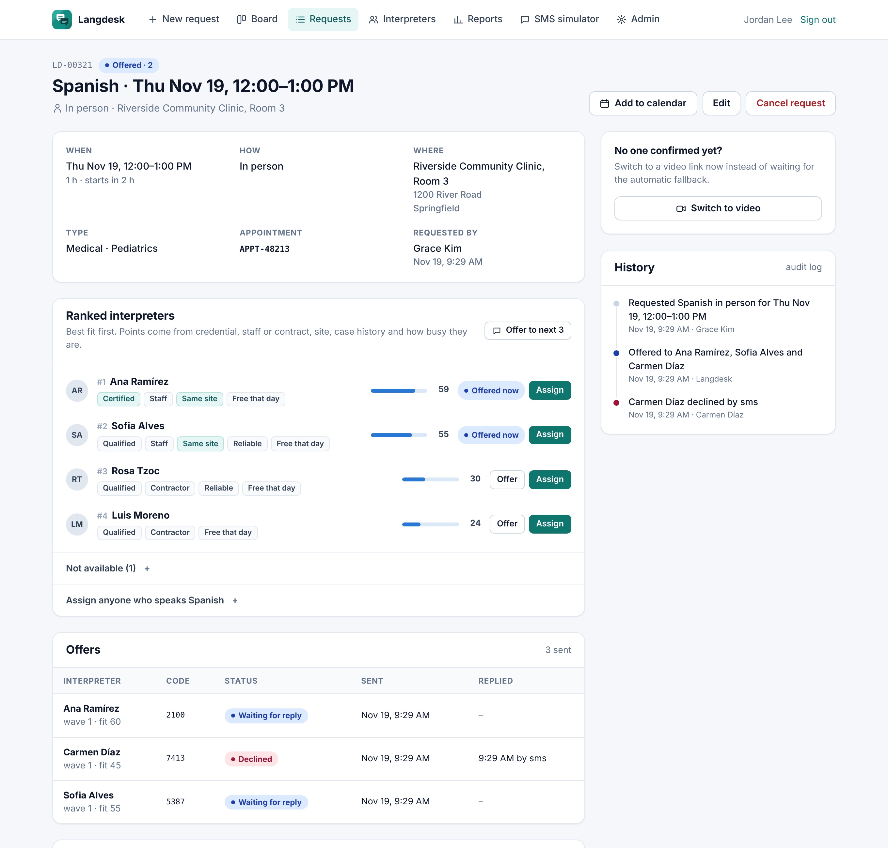
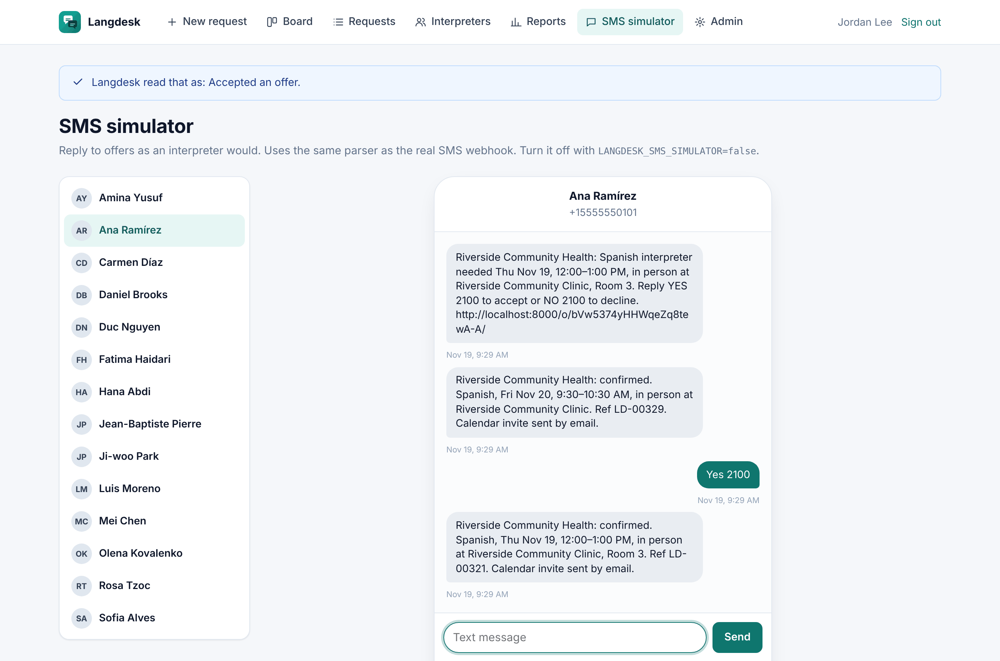
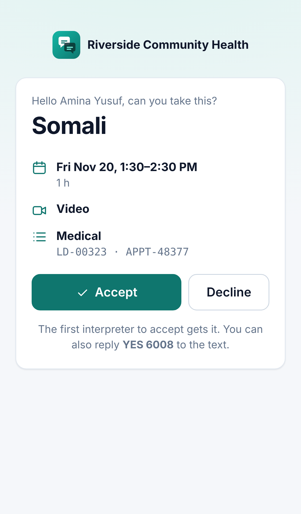
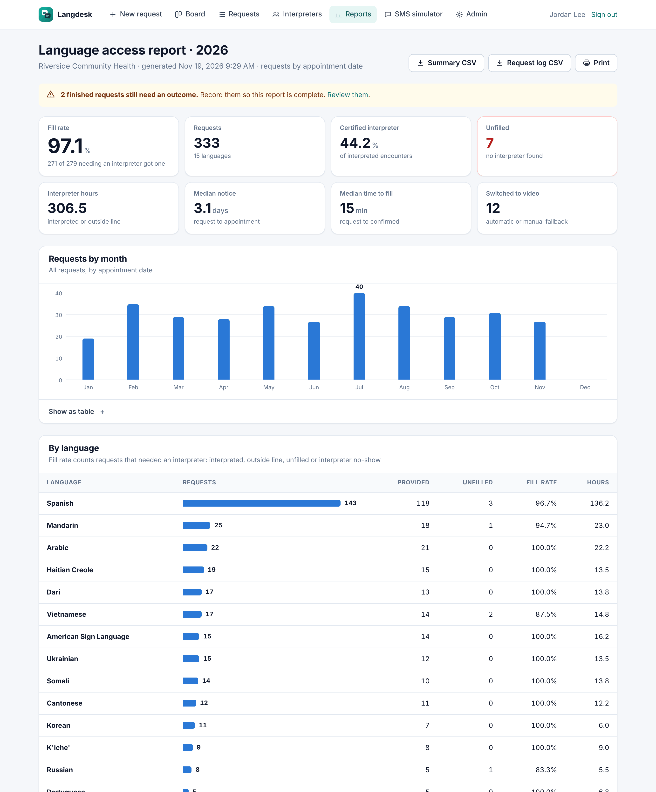
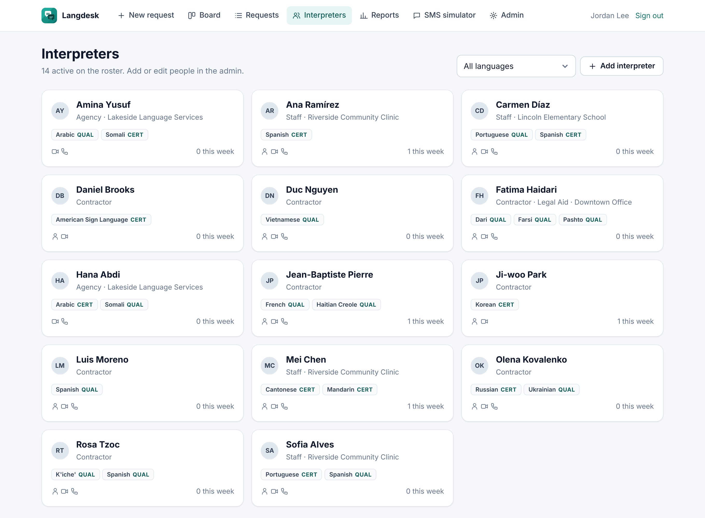
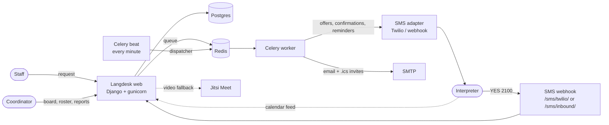
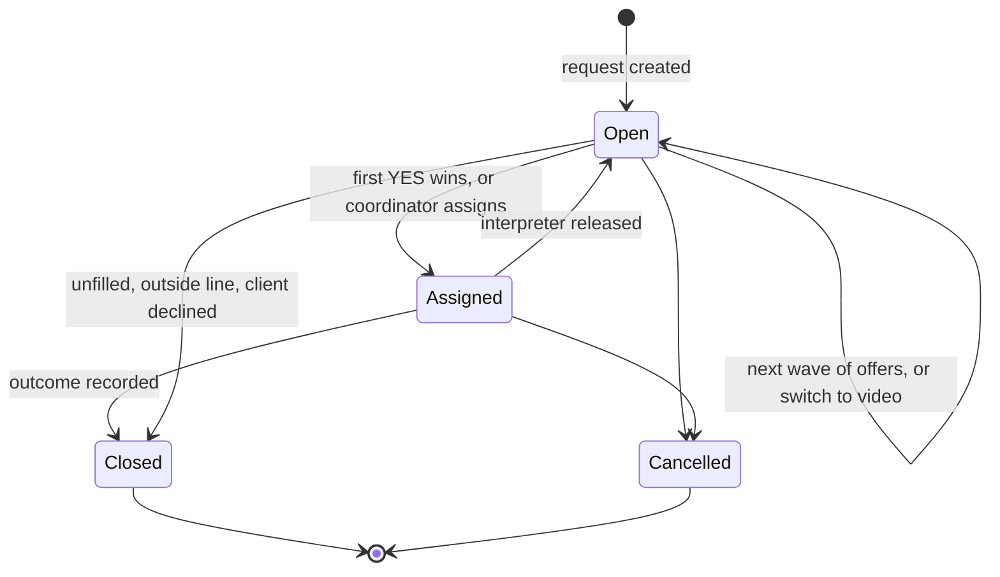

<p align="center">
  
</p>

<p align="center">
  <a href="https://github.com/lobojoel2003/Langdesk/actions/workflows/ci.yml"></a>
  <a href="https://github.com/lobojoel2003/Langdesk/actions/workflows/codeql.yml"></a>
  <a href="https://github.com/lobojoel2003/Langdesk/releases/latest"></a>
  <a href="https://github.com/lobojoel2003/Langdesk/pkgs/container/langdesk"></a>
  
  
  <a href="LICENSE"></a>
</p>

Clinics, schools and legal aid offices must provide interpreters, and most small ones arrange
them by email, phone and spreadsheet. Requests get lost and a child ends up interpreting for a
parent.

**Langdesk** is a small, self-hosted app that fixes that. Staff request an interpreter by
language, time and place. Langdesk ranks your roster of staff and contract interpreters, offers
the job by text, sends reminders and calendar invites, falls back to a video link when nobody can
come in person, and keeps the log that regulators ask for.

<p align="center">
  
</p>

## Contents

- [Why Langdesk](#why-langdesk)
- [What it does](#what-it-does)
- [Quick start](#quick-start)
- [Try the demo](#try-the-demo)
- [How it works](#how-it-works)
- [Configuration](#configuration)
- [Development](#development)
- [Versioning, builds and releases](#versioning-builds-and-releases)
- [Contributing, security and license](#contributing-security-and-license)

## Why Langdesk

About 25 million people in the U.S. have limited English proficiency. Professional interpreter
use rose from 8.3% to 34.9% between 2011 and 2023, so fewer than half get one
([TechTarget, on a JAMA Network Open study](https://www.techtarget.com/patientengagement/news/366632193/ACA-rule-boosted-medical-interpreter-access-health-equity)).
Patients with limited English were harmed in 49.1% of adverse events against 29.5% for English
speakers, and hospitals have paid $80,000 to $200,000 for failing to provide qualified
interpreters ([MagMutual](https://www.magmutual.com/content-library/article/caring-for-patients-with-limited-english-proficiency-lep),
an insurer's summary). Federal rules require qualified interpreters at no cost and bar relying on
untrained family members (TechTarget, same article).

[Boostlingo](https://boostlingo.com/blog/what-is-an-interpreter-scheduling-software/),
[GoFluently](https://gofluently.com/) and
[LinguistLink](https://mindlinkresources.com/linguistlink-scheduling-system/) are paid platforms
sized for hospitals and agencies. The only open source option we found,
bcgov/court-interpreter-scheduling, is built around British Columbia's court system. Langdesk is
for the clinic with two staff interpreters and a list of contractors, the school district that
needs Dari for an IEP meeting, and the legal aid office that books Spanish for intake every
morning.

## What it does

### A request takes 20 seconds

Language, when, where, in person or video. The form remembers the requester's usual site and
department, and the most-requested languages sit at the top of the list.

<p align="center"></p>

**Client details stay out.** A request holds an appointment *reference*, never a name or
diagnosis. Reference fields accept ID-shaped values only, and free-text fields reject anything
that looks like a date of birth, Social Security number, phone number or email address. Texts,
emails and calendar invites carry only language, time, place and reference.

### One board, with the best-fit interpreters already ranked

Coordinators see every open request grouped by day, with the top three interpreters ranked and
the reasons spelled out: *Certified · Staff · Same site · Free that day*. Offer or assign in
one click. Urgent requests are flagged, and the side panels show what's covered and what still
needs an outcome.

<p align="center"></p>

### Interpreters accept by replying to a text

Each offer goes out by text (and email) with a four-digit code. `YES 2100` accepts, `NO 2100`
declines, `HELP` and `STOP` work as expected. The first to accept gets the job, gets a
confirmation with a calendar invite, and everyone else is told it's filled. A link in the text
opens a phone-friendly page to accept or decline instead.

<table>
  <tr>
    <td width="68%"></td>
    <td width="32%"></td>
  </tr>
</table>

The **SMS simulator** above lets you try the whole loop without an SMS provider. In production,
texts go through **Twilio** or a **webhook adapter** for any other provider (see
[docs/sms.md](docs/sms.md)).

### Reminders, calendars and video fallback

- **Reminders** go out a day before and two hours before (configurable), once each, and never
  right after a last-minute confirmation.
- **Calendar invites** (`.ics`, iTIP `REQUEST`/`CANCEL`) are attached to every confirmation,
  change and cancellation, and each interpreter gets a **subscribable calendar feed** that works
  in Google Calendar, Outlook and Apple Calendar.
- **Video fallback:** if nobody has confirmed an in-person request an hour before it starts,
  Langdesk switches it to a **Jitsi Meet** link, tells the requester, and widens the offer to
  remote interpreters. Point it at your own Jitsi server if you have one.
- **Escalation:** when the roster runs out, coordinators get an email so the request can be
  covered by an outside line instead of a family member.

### Every request ends with an outcome, so the yearly report writes itself

After an appointment, staff record what happened: interpreted, client no-show, interpreter
no-show, client declined (a documented waiver), covered by an outside line, or unfilled. The
language-access report turns that into fill rate, certified share, unfilled requests, interpreter
hours, notice and time-to-fill, by language, site, department, service type and month. Export a
summary CSV or the full request log, or print it.

<p align="center"></p>

### And the parts you'd expect

- **Roster management** in the Django admin: languages with credential level and expiry,
  employment type (staff, contractor, agency), sites they travel to, weekly hours, time off,
  daily limits.
- **Audit log** on every request: created, offered, accepted, declined, expired, assigned,
  reminded, switched to video, cancelled, outcome, each with who and when.
- **Roles:** anyone signed in can request and follow their own requests; coordinators run the
  board, roster and reports.
- **52 languages preloaded**, including Mam, K'iche', Q'anjob'al, Marshallese, Chuukese and
  American Sign Language. Sign languages are never offered by phone.

<p align="center"></p>

## Quick start

You need Docker with Compose v2.24 or newer.

```bash
curl -LO https://github.com/lobojoel2003/Langdesk/releases/latest/download/docker-compose.yml
```

```bash
docker compose up -d
```

```bash
docker compose exec web langdesk-entrypoint manage createsuperuser
```

Open <http://localhost:8000> and sign in. That's the whole stack: Postgres, Redis, the web app,
a Celery worker for messages and Celery beat for the dispatcher. A secret key is generated on
first start and kept in the `langdesk-data` volume.

To configure it, download [`.env.example`](.env.example) as `.env` next to the compose file and
edit it: your organisation name, public URL, time zone, email (SMTP) and texts (Twilio or
webhook). Then add your sites, languages and interpreters in **Admin**, and add staff who run the
board to the **Coordinators** group.

For HTTPS, backups and upgrades, see [docs/deployment.md](docs/deployment.md).

<details>
<summary><strong>Run from a clone instead</strong></summary>

```bash
git clone https://github.com/lobojoel2003/Langdesk.git
```

```bash
cd Langdesk && docker compose up -d --build
```

</details>

## Try the demo

Load a fictional organisation with three sites, 14 interpreters, a year of history and a live
board:

```bash
docker compose exec web langdesk-entrypoint manage seed_demo
```

Sign in as `coordinator` (the board), `nurse.kim` (a requester) or `admin`, all with the password
`langdesk-demo`. Open **SMS simulator** to reply to offers as an interpreter.

## How it works



**The request lifecycle.** Every arrow below writes an audit event.



**Ranking.** Hard rules first: the interpreter must speak the language at a qualified or
certified level, work in that mode (in person, video, phone), travel to the site, be inside their
working hours, not be on time off, not be booked (with a travel buffer for in-person work), be
under their daily limit, and not have declined this request. Everyone left is scored:

| Signal | Points |
|---|---|
| Certified for the language (qualified: 20) | 30 |
| Staff interpreter (contractor: 5, agency: 0) | 15 |
| Based at the request's site | 15 |
| Has worked this appointment or case before | 10 |
| Accepts at least 70% of offers | 5 |
| Each job already that day / that week | −6 / −1 |

The **dispatcher** runs every minute (Celery beat, or `manage.py run_dispatcher --loop` from cron
or systemd if you'd rather not run Celery). It expires unanswered offers, sends the next wave,
switches unfilled in-person requests to video, sends due reminders and alerts coordinators when
the roster is exhausted. Every step is idempotent, so a missed minute is harmless.

**Code map.**

| Path | What's there |
|---|---|
| `langdesk/roster/` | Languages, sites, departments, interpreters, credentials, hours, time off |
| `langdesk/scheduling/services/matching.py` | Hard rules and scoring |
| `langdesk/scheduling/services/dispatch.py` | Every state change, with its audit event and messages |
| `langdesk/scheduling/services/notify.py` | Message composition; wording lives in `templates/scheduling/messages/` |
| `langdesk/scheduling/ics.py`, `video.py` | Calendar invites and feeds; Jitsi links |
| `langdesk/messaging/` | Pluggable SMS backends, delivery log, inbound reply parsing and webhooks |
| `langdesk/reports/` | The language-access report and CSV exports |

## Configuration

Everything is set with environment variables (or a `.env` file next to `docker-compose.yml`).
The most common ones:

| Variable | Default | What it does |
|---|---|---|
| `LANGDESK_ORG_NAME` | `Langdesk` | Shown in the app and at the start of every text |
| `LANGDESK_BASE_URL` | `http://localhost:8000` | Public URL used in links, feeds and invites |
| `LANGDESK_TIME_ZONE` | `America/New_York` | Your local time zone |
| `DJANGO_ALLOWED_HOSTS` | `localhost,127.0.0.1` | Hostnames the app answers to |
| `DJANGO_EMAIL_BACKEND`, `EMAIL_HOST`, ... | console | Outgoing email (SMTP) |
| `LANGDESK_SMS_BACKEND` | console | `...console.ConsoleSMSBackend`, `...twilio.TwilioSMSBackend` or `...webhook.WebhookSMSBackend` |
| `TWILIO_ACCOUNT_SID`, `TWILIO_AUTH_TOKEN`, `TWILIO_FROM_NUMBER` | | Twilio credentials |
| `LANGDESK_JITSI_BASE_URL` | `https://meet.jit.si` | Video fallback server |
| `LANGDESK_OFFER_WAVE_SIZE` | `3` | How many interpreters each wave of offers goes to |
| `LANGDESK_OFFER_TIMEOUT_MINUTES` | `20` | How long to wait before the next wave |
| `LANGDESK_VIDEO_FALLBACK_MINUTES` | `60` | When to switch unfilled in-person requests to video (0 turns it off) |
| `LANGDESK_REMINDER_MINUTES` | `1440,120` | Reminder lead times |

The full reference is in [docs/configuration.md](docs/configuration.md).

## Development

Python 3.12 or 3.13. SQLite works for development; CI also runs the suite against Postgres 17.

```bash
python -m venv .venv && . .venv/bin/activate
```

```bash
pip install -r requirements-dev.txt
```

```bash
make demo run
```

That migrates a local SQLite database, loads the demo and serves it at <http://localhost:8000>.
Without Redis, background work runs inline, so you don't need a worker for development.

```bash
make test lint
```

The suite has 150+ tests with coverage held above 90% (currently 98%): ranking rules,
the dispatcher, reply parsing, webhooks and signatures, calendar output, reports and every
view's permissions. See [CONTRIBUTING.md](CONTRIBUTING.md).

## Versioning, builds and releases

Langdesk follows [Semantic Versioning](https://semver.org). The version lives in one place,
[`langdesk/version.py`](langdesk/version.py), and every change is recorded in
[CHANGELOG.md](CHANGELOG.md).

| What | Where you see it |
|---|---|
| **Version** (`1.0.0`) | Git tag `v1.0.0`, GitHub release, image tags, page footer, `/healthz` |
| **Build number** | The GitHub Actions run number that built the image: footer, `/healthz`, image label `io.langdesk.build-number`, tag `1.0.0-build.N` |
| **Commit** | Footer, `/healthz`, image label `org.opencontainers.image.revision` |

```console
$ curl -s localhost:8000/healthz
{"status": "ok", "database": "ok", "version": "1.0.0", "build": "12", "commit": "3f9c2ab", "built_at": "2026-11-19T04:02:11Z"}
```

**CI/CD pipeline** (GitHub Actions):

- **CI** on every push and pull request: Ruff lint and format; tests on Python 3.12 and 3.13
  against Postgres, plus SQLite; migration drift check; `check --deploy` with production
  settings; wheel and sdist build; Docker build with a full `docker compose` smoke test.
- **Continuous delivery** on `main`: multi-arch images (`linux/amd64`, `linux/arm64`) pushed to
  `ghcr.io/lobojoel2003/langdesk` as `edge`, `sha-<commit>` and `<version>-build.<N>`.
- **Release** on a `vX.Y.Z` tag: checks the tag matches `version.py`, reruns CI, publishes images
  tagged `X.Y.Z`, `X.Y`, `X` and `latest` with SBOM and signed build provenance, and creates a
  GitHub release with notes from the changelog, the wheel and sdist, `docker-compose.yml`,
  `env.example` and `SHA256SUMS.txt`.
- **CodeQL** security analysis weekly and on every change to `main`; **Dependabot** for Python
  packages, Actions and base images.

To cut a release, see [docs/releasing.md](docs/releasing.md).

## Contributing, security and license

Contributions are welcome. Start with [CONTRIBUTING.md](CONTRIBUTING.md). Please report security
issues privately as described in [SECURITY.md](SECURITY.md).

Langdesk is free software under the [GNU Affero General Public License v3.0](LICENSE). If you run
a modified version for others over a network, you must offer them its source.
